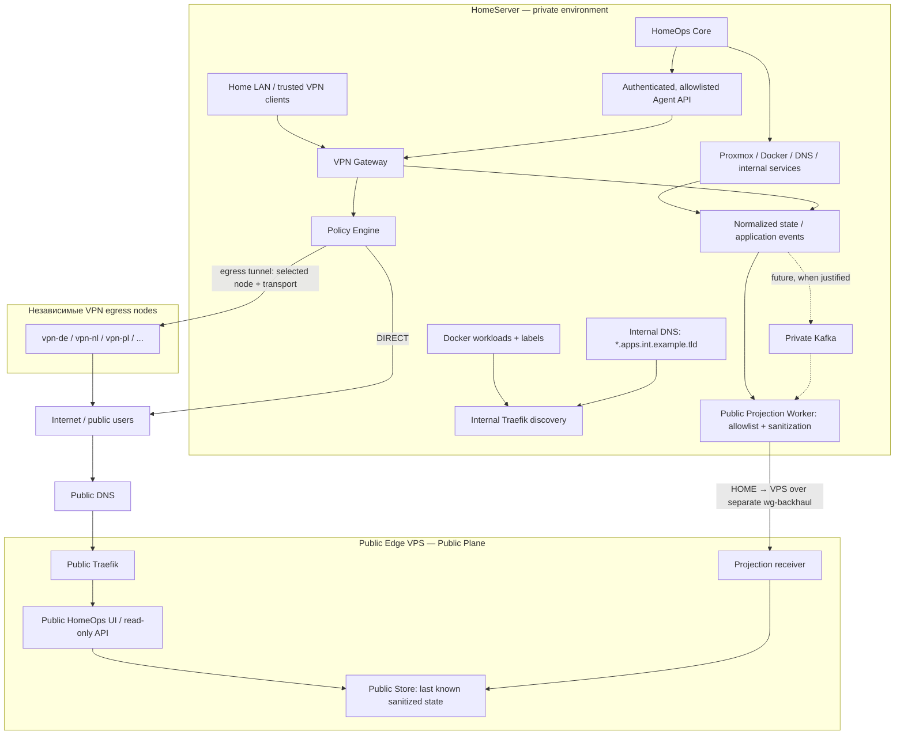

# HomeServer Network: целевая архитектура

## Назначение и статус

**Target-state, а не описание уже развёрнутой сети.** HomeServer/HomeOps — долгосрочная учебная инфраструктурная площадка и портфолио-проект: DevOps, SRE, сети, backend, observability, IaC, CI/CD, event-driven архитектура и эксплуатация self-hosted сервисов. Развиваем небольшую понятную платформу постепенно; сложность должна решать реальную проблему и давать объяснимый учебный результат.

HomeServer — главное private infrastructure environment и будущий infrastructure/meta repository. HomeOps остаётся самостоятельным приложением: infrastructure control plane + observability view + network policy interface + отдельный public portfolio showcase. Он интегрирует Proxmox, Prometheus, Grafana, Traefik, DNS server, Kafka, Ansible и OpenTofu, не заменяя их.

Этот документ — источник общей Network target architecture, границ, решений и этапов. [Общие инфраструктурные правила](infrastructure-security.md) задают общий учебный порядок и миграции; [архитектура VPN](vpn-architecture.md) — Gateway, Agent, nodes и policies; [эксплуатация VPN](vpn-operations.md) — health, auto-heal и failover; [VPN roadmap](vpn-roadmap.md) — развитие этого домена. Текущая реализация приложения описана в [README](../README.md). Документ не разрешает миграцию, установку сервисов или изменение staging/production.

## Эволюция существующих решений

Current-state ниже означает ранее сообщённый контекст, а не свежую проверку серверов. Предыдущие идеи сохранены; legacy означает прежний вариант проектирования, не обязательно реализованный компонент.

| Область | Current-state / прежнее решение | Target-state |
| --- | --- | --- |
| Internal ingress | NPM и `acme.sh → shared certificates → NPM` | Отдельный internal Traefik, declarative discovery; перенос по существующим правилам безопасной миграции |
| DNS | AdGuard Home | Сначала wildcard и API automation, затем более глубокая интеграция; Technitium DNS Server — основной кандидат при подтверждённой потребности |
| Домен и TLS | DuckDNS; прежняя целевая TLS-цепочка была привязана к нему | Собственный домен и подходящий DNS provider с DNS-01; реальный домен пока не выбран |
| VPN | Проектирование вокруг DIRECT/AWG/XRay и одного внешнего VPS | Динамический набор provider-independent egress nodes; node, transport и policy — разные сущности |
| Публичная поверхность | В приложении нет отдельной Public Projection или Public Store | HomeOps Core private; Public HomeOps на Edge читает только очищенную локальную проекцию |
| Events | Event backbone не реализован | Application events сначала, Kafka — только обоснованный будущий этап |
| Persistence | HomeOps хранит записи в памяти; для VPN ранее предложена SQLite | PostgreSQL возможен внутри дома по потребности; public read model имеет отдельное хранилище без доступа к private DB |

H1Cloud — текущий план для нескольких VPN VPS, а не выбранная навсегда зависимость. Наличие NPM, DuckDNS или AdGuard не делает инфраструктуру ошибочной и не является поводом немедленно её менять.

## Контуры и planes

Home LAN (клиенты), internal service network, internal ingress, VPN Gateway, внешние VPN egress nodes, infrastructure backhaul, Public Edge, Public HomeOps, internal/public DNS, observability и HomeOps network control plane имеют разные обязанности. Логические контуры не требуют немедленно выделять отдельный сервер или VLAN для каждого.

| Plane | Ответственность и компоненты |
| --- | --- |
| Network / Data Plane | Gateway, VPN nodes, WireGuard/AmneziaWG и другие разрешённые transports, routing, NAT, Traefik, DNS |
| Control Plane | Private HomeOps, network policy engine, health manager, configuration, IaC, automation; применение сетевых операций через controlled Agent |
| Event Plane | Application events, audit, notifications; Kafka в будущем |
| Observability Plane | Prometheus, Grafana, Loki, Alertmanager; измерение и диагностика |
| Public Plane | Public Edge, Public HomeOps, public DNS, sanitized read model |

Это разделение ответственности, не требование пяти отдельных физических систем. Policy Engine задаёт решение о маршруте; Gateway применяет его в Data Plane. Распределение control-компонентов между HomeOps и локальным daemon уточняется при реализации с сохранением автономности шлюза.

Логическая схема (стрелки показывают назначение потока, не готовые firewall rules):



Observability собирает показатели этих контуров по разрешённым путям; её стек опущен на схеме для читаемости. Схема не разрешает Edge обращаться к внутренним integrations и не означает, что DNS проксирует HTTP.

## Private environment и security boundaries

В домашнем контуре находятся или планируются Proxmox, LXC/VM, Docker workloads, HomeOps Core, internal Traefik, DNS, monitoring, PostgreSQL, Forgejo, CI/CD runners, VPN Gateway, administrative services и будущая Kafka/event infrastructure. Перечень определяет место компонентов в target-state, а не утверждает их установку. Home LAN и service network постепенно получают явные границы доступа по общему roadmap security zones.

Private control plane никогда не публикуется напрямую в Internet: Proxmox API/UI, Docker socket/API, HomeOps administrative API, DNS/VPN/Forgejo administration, Ansible/OpenTofu control paths, secrets, internal Kafka, internal PostgreSQL и backup administration. Публичный reverse proxy с authentication сам по себе не делает публикацию этих interfaces целевой моделью. Доступ доверенных администраторов — через отдельно разрешённый private management path.

Принцип Home ↔ VPS: **allow only explicitly required flows**. Шифрование WireGuard не заменяет firewall и аутентификацию приложения. Для каждого разрешения фиксируются source, destination, protocol, port, service и причина; остальное запрещено. Пример границ, не готовая конфигурация:

| Источник → назначение | Разрешённый смысл потока | Граница |
| --- | --- | --- |
| Internet → Edge public Traefik | Публичный HTTPS к showcase | Только Public UI/API, без private administrative routes |
| Home projection worker → Edge projection receiver | Отправка разрешённого snapshot/update, например HTTPS/TCP 443 внутри backhaul | Отдельная identity с правом записи только public projection; receiver не даёт control-доступ домой |
| Edge → Home | Ответы на разрешённые исходящие соединения; иные потоки только по отдельному обоснованию | Нет широкого транзита в LAN, доступа к private API/DB или новым management sessions |
| Home Gateway → выбранный VPN node | Egress transport и связанный обратный трафик | Egress node не получает роль домашнего control plane |
| Доверенный internal client → internal ingress/service | Явно разрешённый сервис | DNS-имя и обнаружение через labels не являются правом доступа |

Даже внутри backhaul нельзя автоматически разрешать `VPS → entire <HOME_LAN_CIDR>` или весь Home LAN. Компрометация VPS не должна открывать домашнюю сеть. Public ingress, backhaul receiver и VPN transport endpoints имеют самостоятельные правила и credentials. Точные адреса, порты и механизмы изоляции выбираются в отдельной задаче; их нельзя вывести из этой логической схемы.

## Internal ingress, DNS и naming

Internal Traefik — целевой reverse proxy и service-discovery layer:

```text
Docker service → Docker labels → Traefik Docker provider → internal hostname
grafana       → declarative route                      → grafana.apps.int.example.tld
*.apps.int.example.tld → internal Traefik IP
```

Для Docker workloads не создавать вручную proxy-host, если route можно описать декларативно. Workloads публикуются в ingress только явно; discovery не должен автоматически открывать все контейнеры. Доступ Traefik к Docker API ограничивается необходимыми операциями, socket не публикуется в Internet. Для не-Docker сервисов допустима явная декларативная конфигурация соответствующего provider. Wildcard DNS направляет имя на ingress, но не создаёт route, сертификат или разрешение firewall.

AdGuard Home можно сохранять: `AdGuard → wildcard DNS + API automation → более глубокая DNS-интеграция → Technitium при необходимости`. На этапе реализации отдельно проверяются возможности текущей версии, wildcard, управление зонами/API, backup/restore и миграционный rollback. Technitium — основной кандидат infrastructure DNS, не немедленная обязательная замена.

Собственный домен абстрагирует физические серверы и providers. Во всей общей документации используется только `example.tld`; точное имя не фиксируется. Имена логических ролей сохраняются при замене VPS. Страны и количество VPN nodes — данные inventory, не константы приложения.

| Пространство | Примеры | Кто разрешает / назначение |
| --- | --- | --- |
| Public services | `homeops.example.tld`, `status.example.tld` | Public DNS → Edge; status может быть отдельной будущей public поверхностью |
| Infrastructure | `edge.example.tld` | Имя Edge-роли; наличие записи не разрешает management-доступ |
| VPN egress | `vpn-pl.example.tld`, `vpn-de.example.tld`, `vpn-nl.example.tld`, `vpn-fi.example.tld`, `vpn-ch.example.tld` | Endpoint naming для динамического inventory, не обязательный список закупок |
| Internal infrastructure | `proxmox.int.example.tld`, `grafana.int.example.tld`, `dns.int.example.tld`, `kafka.int.example.tld` | Internal DNS; private services |
| Internal applications | `*.apps.int.example.tld` | Internal DNS → internal Traefik IP |

`grafana.apps.int.example.tld` иллюстрирует discovery; `grafana.int.example.tld` может быть инфраструктурным именем/alias. При реализации выбрать одно canonical имя сервиса, не создавать два независимых deployment ради примеров.

Split DNS разделяет ответы/зоны для internal и public clients: public DNS обслуживает публичные endpoints; private records доступны через internal resolver. При необходимости один FQDN может иметь разные ответы внутри и снаружи. Private addresses и topology не публикуются в public DNS; DNS-01 challenge records для TLS рассматриваются отдельно. DNS не является механизмом авторизации.

Цель TLS: `Traefik ↔ ACME ↔ DNS-01 ↔ DNS provider собственного домена ↔ CA`. Прежняя DuckDNS-цепочка и NPM/acme.sh сохраняются как current/transition context в [инфраструктурных правилах](infrastructure-security.md#безопасные-миграции-и-traefik). Internal/public ingress имеют отдельную конфигурацию, scope credentials и lifecycle.

## Egress, backhaul и Public Edge

Клиент идёт через Home VPN Gateway только в рамках выбранной политики: `Client → Gateway → Policy Engine → DIRECT или выбранный VPN node → Internet`. Не направлять весь домашний трафик в VPN без необходимости. Динамическая модель узлов, правила и локальный Agent описаны в [VPN architecture](vpn-architecture.md#vpn-nodes-и-network-policy). Egress nodes не являются обязательным control plane.

| Роль | Путь и назначение | Изоляция |
| --- | --- | --- |
| Egress, логически `wg-egress` | Home → выбранный VPS → Internet; WireGuard/AmneziaWG либо другой разрешённый transport | Собственные interfaces/instances, addressing, routes/tables, NAT и firewall по модели transport |
| Infrastructure backhaul, `wg-backhaul` | Home ↔ Edge/VPS infrastructure; предпочтительно отдельный WireGuard tunnel | Отдельные keys, interfaces, addressing, routing и firewall; не default route домашнего Internet-трафика |
| Public Edge | Internet → public DNS → Edge VPS → public Traefik → public services | Public ingress и public data отделены от VPN egress и private ingress |

Имена interfaces здесь концептуальны, не готовая настройка. Отказ egress transport не должен менять backhaul routing; независимость при отказе целого host требует разных hosts. Public Edge предпочтительно располагается на отдельном VPS, а VPN nodes выполняют только egress. Первоначальное совмещение на одном VPS допустимо как компромисс стоимости при раздельных ролях, сетях, правах и конфигурации; общий host остаётся общей точкой отказа и не эквивалентен физической изоляции.

Для других будущих public services доступ через Edge проектируется по конкретному flow. Это не разрешает универсальный reverse proxy в Home LAN. Для Public HomeOps используется только следующий путь проекции.

## HomeOps Core, Public Projection и Public Store

**HomeOps Core** private: интеграции Proxmox, Docker, DNS, VPN, deployment, monitoring, secrets и administration. **HomeOps Public** — read-only showcase для работодателей и портфолио: состояние сервисов, uptime, deployment history, разрешённые metrics, архитектура и безопасные events. Public API не содержит administrative operations и не использует private credentials.

```text
HomeOps Core / normalized state
  → Public Projection Worker (selection + transformation + sanitization)
  → authenticated transport, преимущественно HOME → VPS
  → Edge projection receiver → Public Store
  → read-only Public API → Public frontend → visitor
```

Public visitor работает только с VPS. Цепочка `Employer → VPS → HomeServer → administrative HomeOps API` на каждый запрос не является target-state. Public frontend не вызывает private backend. Core и Public могут переиспользовать код, но имеют отдельные API surfaces, deployment configuration, permissions и storage access. Один API с одновременно public и administrative permissions не считается достаточным разделением.

Public Projection — allowlist публичных данных, а не зеркало внутреннего состояния:

| Допустимо после явного выбора | Не экспортировать |
| --- | --- |
| Service display name, public status, uptime, разрешённая software version, last deployment/history | Credentials, tokens, secrets, VPN private keys |
| Sanitized metrics, public architecture metadata, выбранная безопасная event history | Internal IP, private hostnames, internal routes, непредназначенная для публикации LAN topology |
| Публичные логические идентификаторы и freshness metadata | Необязательные Docker IDs, раскрывающие инфраструктуру Proxmox IDs, сырые logs/events или credentials в error messages |

Пример transformation (значения условные):

```json
{
  "internal": {
    "host": "<private-host>",
    "ip": "<internal-ip>",
    "docker_id": "<internal-id>",
    "service": "grafana",
    "status": "running"
  },
  "public": {
    "service": "Monitoring",
    "status": "online"
  }
}
```

Новые поля запрещены к публикации по умолчанию. Отбор и transformation относятся к worker, а не к сокрытию полей frontend. Публичная topology также строится только из разрешённой проекции. Receiver принимает только согласованную public schema; его credentials дают доступ к записи проекции, не к private infrastructure.

Public Store — отдельное read-model хранилище на Edge; выбор SQLite, иной DB или snapshot-файла откладывается до use case. Нет administrative connection обратно домой, live joins с private PostgreSQL, репликации всей private DB или доступа к internal Kafka. Первый transport может быть простым push snapshot по HTTPS через backhaul; broker не требуется.

Для будущего протокола нужны schema version, время последнего успешного обновления, понятная обработка повторной/устаревшей доставки и атомарное применение snapshot. При отказе отправки сохраняется last known state, создаётся `public_projection.failed`; устаревшие данные показываются как stale/unknown или maintenance, а не как подтверждённый текущий uptime. Retention и частота обновления определяются практическим объёмом данных; не проектировать распределённую платформу заранее.

### Независимость private и public

Public showcase зависит от private infrastructure настолько мало, насколько разумно. Private control plane не зависит от Public Edge для локальной работы.

| Отказ | Ожидаемое поведение target-state |
| --- | --- |
| Edge недоступен | Home LAN, internal DNS, HomeOps Core, Proxmox и internal services продолжают локальную работу; projection delivery диагностируется отдельно |
| HomeServer недоступен | Edge и Public HomeOps показывают последнее полученное состояние с freshness/maintenance status; запросы посетителя не зависают на обращении домой |
| Один egress node недоступен | Применяется разрешённая VPN policy/fallback; public ingress и backhaul не зависят от этого узла |
| Kafka или public projection недоступны | Basic HomeOps functionality и локальные разрешённые маршруты не требуют работающей Kafka или Public Store |

Не объединять один public/private Traefik, один VPN interface для всех потоков, public read API и private administrative permissions, обязательный control plane на egress node или синхронную зависимость Core от Kafka.

## Event Plane и Kafka

Эволюция: `application events → background workers → возможно Redis/NATS → Kafka при реальной необходимости`. Redis и NATS — возможные альтернативы под конкретную задачу, не обязательные ступени установки. Сначала нужны понятные producers/consumers, требования к delivery/replay/retention и несколько реальных сценариев; Kafka не является текущим dependency или условием basic HomeOps functionality.

В будущем Kafka может стать private event backbone. Возможные producers: Proxmox Collector, Docker Collector, VPN Collector, DNS Collector, CI/CD, Backup Monitor, Certificate Monitor, HomeOps services. Примеры event types/возможных topics: `service.status.changed`, `vpn.node.health.changed`, `vpn.route.changed`, `vpn.node.failed`, `vpn.node.recovered`, `deployment.completed`, `backup.completed`, `certificate.expiring`, `dns.record.changed`. Это семантические примеры, не обязательный отдельный topic на каждый event.

Будущий путь: `Internal systems → Kafka → Public Projection Worker → sanitized data → Edge`. Worker выполняет transformation/sanitization, не копирует internal events наружу. Kafka listeners не публикуются в Internet; Public API и Edge не читают private broker напрямую. При выборе Kafka нужно обосновать replay, порядок, delivery semantics, storage/retention и эксплуатационную стоимость по сравнению с простыми workers.

## Observability, Network events и UI

Предпочтительный стек: Prometheus (metrics), Grafana (dashboards), Loki (logs), Alertmanager (alerts). HomeOps предоставляет агрегированное infrastructure view и ссылки/интеграции, не пытаясь заменить специализированные инструменты.

Постепенно наблюдать VPN latency, packet loss, node health/load, tunnel state, traffic, failovers, route changes, DNS health, internal/public Traefik health, Edge health и Home ↔ VPS backhaul health. Для public projection наблюдать доставку и возраст последнего snapshot. Различать отсутствие telemetry и подтверждённый отказ. VPN-specific probes, thresholds и recovery остаются в [эксплуатации VPN](vpn-operations.md).

Network events предназначены для audit, monitoring, notifications, UI и future automation. Примеры: `vpn.node.unhealthy`, `vpn.node.recovered`, `vpn.route.changed`, `vpn.failover.started`, `vpn.failover.completed`, `tunnel.down`, `tunnel.restored`, `dns.unhealthy`, `edge.unreachable`, `public_projection.failed`. При реализации согласовать единый словарь с `vpn.node.health.changed` и `vpn.node.failed`, не создавать дубли одного перехода ради разных имён.

Событие должно объяснять время, источник, тип, затронутую сущность, причину, старое/новое состояние и correlation/decision ID при наличии. Internal event может содержать диагностический контекст; public event создаётся отдельно через allowlist. Kafka не нужна для первого audit log или уведомления.

Будущий private раздел HomeOps:

```text
Network
├── Overview
├── Nodes
├── VPN
├── Routes
├── Policies
├── DNS
├── Edge
├── Health
├── Traffic
├── Events
└── Failover
```

Это target navigation, не задача создать все страницы. Существующие идеи VPN Dashboard/Transports/Devices/Settings сохраняются как подстраницы соответствующих Network-разделов. Topology/dependency graph строится из нормализованных nodes, services и связей (gateway → egress, ingress → service, projection → store), с состоянием и временем наблюдения; не из жёстко зашитой картинки. Public graph использует только public metadata.

## IaC, GitOps и secrets

Сохраняется существующее разделение HomeServer/HomeOps и целевое дерево `infra/` из [инфраструктурных правил](infrastructure-security.md#homeserver-и-границы-проектов). Не создавать конкурирующее `infrastructure/`. Возможное размещение по мере появления реальной конфигурации:

| Существующая или будущая область HomeServer | Назначение |
| --- | --- |
| `infra/opentofu/` | Provisioning VPS/LXC/VM/resources, где применимо и поддерживается provider |
| `infra/ansible/` | OS, network, firewall и service configuration |
| `infra/traefik/` | Раздельная декларативная конфигурация internal и public ingress |
| `infra/network/{dns,vpn,firewall,nodes,policies}/` | Desired network data/configuration; использовать уже имеющийся аналог при его появлении |
| `environments/` и `vpn/` | Существующее разделение окружений и самостоятельных VPN-компонентов; не дублировать их код в network inventory |

Это схема ответственности, не создание каталогов. У каждого параметра один authoritative source; генерируемые файлы не становятся второй независимой конфигурацией. Git хранит desired state, observed health/latency хранится как runtime telemetry. Декларативное управление policies вводится постепенно: review → validation/dry-run → контролируемое применение → audit/rollback, без конкурирующих записей UI и Git.

Целевая цепочка исполнения: `OpenTofu → provisioning → Ansible → configuration`; Git — source of truth, CI/CD — validation/deployment. Учебный порядок остаётся прежним: понятная ручная настройка → Ansible → OpenTofu, не массовый перенос в IaC.

VPN private keys, API tokens и DNS credentials не хранятся в Git plaintext. Target — SOPS + age по [общим secrets rules](infrastructure-security.md#secrets-и-границы-публикации); Vault возможен как поздняя учебная тема при отдельной потребности. Private/public роли получают отдельные минимальные credentials.

## Решения и учебные компромиссы

По [правилам документации](documentation.md#состояние-решения-и-эксплуатационные-знания) до оформления HomeServer решения находятся в тематических правилах; отдельная ADR-структура пока не используется. Ниже содержательные записи в формате Context / Decision / Alternatives / Consequences с учебной целью. При появлении `docs/adr/` переносить/связывать эти решения, сохраняя историю и не создавая дубликаты. Принято направление, не дата внедрения.

| Тема / Context (проблема) | Decision (причина выбора) | Alternatives | Consequences / trade-offs | Learning goal |
| --- | --- | --- | --- | --- |
| NPM → Traefik: ручные proxy-host плохо связываются с workload configuration | Internal Traefik + labels/discovery; отдельный public instance | Сохранить NPM; ручная конфигурация reverse proxy | Освоение providers, TLS и безопасного Docker API access; нужна параллельная миграция с rollback | Объяснить discovery и продемонстрировать новый route без ручного proxy-host |
| AdGuard / Technitium: ad-block DNS может перестать покрывать инфраструктурные задачи | Сохранить AdGuard; развивать wildcard/API; Technitium — основной кандидат при выявленном пробеле | Остаться на AdGuard; другой DNS server | Не добавлять второй DNS ради названия; проверять миграцию зон, resolver behaviour и restore | Сравнить DNS-модели на реальном use case |
| Own domain + split DNS: naming не должен зависеть от DDNS/VPS provider или раскрывать LAN | Собственный домен, internal/public resolution, wildcard applications | DuckDNS как transition; отдельные несвязанные имена | Стоимость домена, управление зонами/credentials и диагностика split answers | Показать DNS resolution и DNS-01 без публикации private records |
| Multi-VPS + provider-independent nodes: один endpoint/transport ограничивает выбор и отказоустойчивость | Inventory VpnNode с provider/region/capabilities, policy выбирает eligible node + transport | Один VPS; фиксированный список стран; provider-specific model | Стоимость VPS, больше health-сигналов; общий домашний Gateway всё ещё точка отказа | Объяснить eligibility, selection, fallback и независимость модели от provider |
| Egress / backhaul: общий tunnel смешивает Internet routing и infrastructure access | Разные interfaces, addressing, routing, firewall, credentials | Один общий tunnel/table | Больше конфигурации, но понятные trust boundaries и независимое изменение маршрутов | Проверить разрешённые и запрещённые flows и влияние отказа egress |
| Public Edge: домашний ingress не должен стать публичным control entrypoint | Отдельная роль, предпочтительно отдельный VPS | Прямой ingress домой; временное совмещение с egress | Дополнительная стоимость; на одном host остаётся общий failure domain | Объяснить ingress/egress и продемонстрировать ограниченный backhaul |
| Core / Public / Projection: showcase не должен зависеть от home API на каждый запрос | Sanitized projection → отдельный Public Store/API/UI; HOME → VPS | Live proxy к Core; полная репликация; простой статический snapshot как первый read model | Eventual consistency, schema/freshness и sanitation; меньше связанность и exposure | Показать работу showcase при отключённом HomeServer и проверить отсутствие private data |
| Kafka: будущим нескольким consumers могут понадобиться retained events/replay | Отложенный private backbone, когда подтверждены use cases | Application events/workers; Redis/NATS при необходимости | Broker operations, хранение и delivery semantics стоят усилий; basic Core независим | Сравнить варианты и продемонстрировать replay/consumers, прежде чем внедрять |
| Observability: ping не объясняет состояние сети и переключения | Интеграция Prometheus/Grafana/Loki/Alertmanager с HomeOps | Только локальные logs/probes; попытка написать весь monitoring самостоятельно | Постепенные dashboards/alerts, retention и tuning вместо лишнего дублирования | Связать symptom → metric/log/event → diagnosis → recovery |
| Network IaC/secrets: ручной drift и повторяемость конфигурации | Git desired state, Ansible/OpenTofu по этапам, SOPS + age | Ручная настройка на старте; Vault позднее | Освоение state, idempotency и восстановления ключей; не автоматизировать непонятый процесс | Воспроизвести малое изменение и объяснить plan/diff/rollback |

Для каждого нового компонента или существенно нового применения перед реализацией уточнять problem statement, reason for adoption, alternatives, trade-offs и learning goal. Решение должно быть объяснимо на собеседовании и демонстрироваться проверяемым сценарием. Не добавлять технологии ради списка в портфолио.

## Поэтапное развитие Network

Это детализация [общего учебного плана](infrastructure-security.md#поэтапный-учебный-план-homeserverhomeops), а не его замена или жёсткие milestones. Ближайшие CI/CD задачи сохраняются. Внутри каждого шага — маленькая объяснённая практика; security, backup и минимальная диагностика нужны с первого затронутого компонента.

| Ориентир | Практический результат / чему учимся | Критерий готовности к следующему усложнению |
| --- | --- | --- |
| Стабилизация current-state | Proxmox, Docker, AdGuard, NPM, существующие сервисы; фактическая topology | Известны зависимости, доступ, backup/restore и исходный маршрут |
| Internal discovery | NPM → Traefik, labels, internal wildcard DNS | Один тестовый service discovery, HTTPS и rollback проверены; собственный домен не требуется покупать раньше согласованного шага |
| Первый VPN egress | Отдельный Gateway, один node, ручные policies | Понятны DIRECT/VPN/BLOCK, routes и проверка выхода; working ingress сохранён |
| Несколько nodes | Динамический inventory HomeOps, health monitoring | Каждый node/transport различается, probes проверяют реальный путь; см. VPN roadmap |
| Policy Engine и failover | Deterministic policies, dry-run, аудит и контролируемое переключение | Проверены разрешённые fallback, thresholds, отмена/rollback и объяснение решения |
| Домен и split DNS | Собственный домен, public DNS, internal/public ответы | Naming отвязан от provider, private records не раскрыты; можно сдвинуть раньше по потребности TLS |
| Public Edge и backhaul | Отдельный ingress, WireGuard backhaul, firewall boundaries | Разрешённые flows проверены, широкого доступа VPS → LAN нет; egress/backhaul независимы |
| Public showcase | Read-only HomeOps Public, Projection, Store | Проверены allowlist, freshness и работа на last known state при недоступном доме |
| Observability integration | Network dashboards/events/alerts и topology | Можно обнаружить и объяснить контролируемый отказ; базовые metrics введены ещё на ранних этапах |
| Event-driven расширение | Workers и, если обосновано, Kafka | Несколько реальных producers/consumers, понятные replay/delivery requirements; Core и showcase читают своё состояние при сбоях доставки |

Technitium, Vault, Kafka и дополнительные VPS появляются по подтверждённой задаче и учебной готовности, не по номеру строки. Каждая миграция сохраняет рабочий путь и rollback; этот roadmap не меняет runtime infrastructure.
